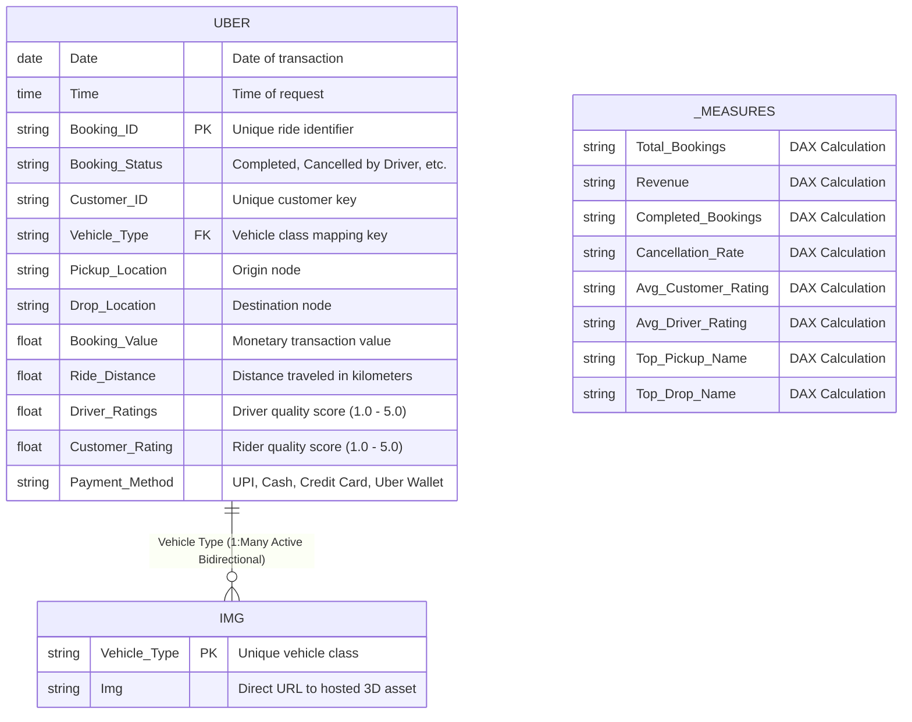

<div align="center">

# 🚗 Uber Ride Analytics & Fleet Intelligence Platform
### Enterprise Business Intelligence, Geospatial Demand Modeling & Operational Telemetry

[](https://powerbi.microsoft.com/)
[](https://learn.microsoft.com/en-us/dax/)
[](https://learn.microsoft.com/en-us/powerquery-m/)
[](https://www.python.org/)
[](https://opensource.org/licenses/MIT)

<br/>


</div>

---

## 📑 Table of Contents
1. [Executive Summary](#-executive-summary)
2. [Problem Statement & Business Objectives](#-problem-statement--business-objectives)
3. [Key Performance Indicators (KPIs)](#-key-performance-indicators-kpis)
4. [Dashboard Architecture & Interactive Features](#-dashboard-architecture--interactive-features)
5. [Data Architecture & Relational Model](#-data-architecture--relational-model)
6. [Data Dictionary & Schema Specification](#-data-dictionary--schema-specification)
7. [Comprehensive DAX Measures Library](#-comprehensive-dax-measures-library)
8. [Data Transformation & M Query Pipeline](#-data-transformation--m-query-pipeline)
9. [Key Business Insights & Findings](#-key-business-insights--findings)
10. [Repository Structure](#-repository-structure)
11. [Setup & Reproduction Guide](#-setup--reproduction-guide)
12. [Troubleshooting & FAQs](#-troubleshooting--faqs)
13. [Future Roadmap](#-future-roadmap)
14. [Contributing & License](#-contributing--license)

---

## 📌 Executive Summary

The **Uber Ride Analytics & Fleet Intelligence Platform** provides an interactive, enterprise-grade business intelligence solution designed to monitor, analyze, and optimize multi-category urban mobility operations. Processing over **148,770+ ride transactions**, this platform unifies operational efficiency, dynamic pricing performance, customer cancellation patterns, and driver telemetry into a consolidated executive view.

By combining native Power BI Button Slicers with custom 3D isometric vehicle assets, parameter-driven time bookmarks, and fault-tolerant DAX calculations, stakeholders can drill down into granular market performance across all seven distinct urban mobility segments.

---

## 🎯 Problem Statement & Business Objectives

Urban ridesharing ecosystems operate in high-frequency, dynamic environments where platform economics depend on balanced supply and demand. Inefficiencies often result in lost trip volume, unfulfilled driver time, customer drop-off, and reduced margin capture.

### Primary Objectives:
* **Quantify Trip Leakage:** Identify cancellation root causes, distinguishing customer cancellations ($7\%$) from driver cancellations and system timeouts to recapture unfulfilled demand.
* **Analyze Fleet Mix Elasticity:** Evaluate revenue and volume distribution across vehicle segments (`Auto`, `Bike`, `eBike`, `Go Mini`, `Go Sedan`, `Premier Sedan`, and `Uber XL`).
* **Pinpoint Geospatial Hotspots:** Map supply bottlenecks across high-frequency pickup nodes (e.g., *Khandsa*) and primary destination drops (e.g., *Ashram*).
* **Track Quality Telemetry:** Continuously correlate rider sentiment ($4.40 / 5.00$) against driver feedback ($4.23 / 5.00$) to identify fleet training opportunities.

---

## 📊 Key Performance Indicators (KPIs)

The following operational metrics summarize total platform throughput within the reporting window:

```
+-----------------------------------------------------------------------------------------+
|                                    PLATFORM OVERVIEW                                    |
+---------------------+---------------------+---------------------+-----------------------+
|   TOTAL BOOKINGS    |    COMPLETED RIDES  |    LOST BOOKINGS    |  CANCELLATION RATE    |
|        149K         |         93K         |         57K         |        7.0%           |
+---------------------+---------------------+---------------------+-----------------------+
|    GROSS REVENUE    |    TOTAL DISTANCE   |   AVERAGE DISTANCE  |  CUSTOMER / DRIVER    |
|        $47M         |        2M km        |        26 km        |   4.40★  /  4.23★     |
+---------------------+---------------------+---------------------+-----------------------+
```

| Metric Name | Value | Calculation Formula | Business Significance |
| :--- | :--- | :--- | :--- |
| **Total Bookings** | **149K** | $\sum \text{Booking Count}$ | Overall market demand volume |
| **Completed Bookings** | **93K** | $\sum (\text{Status} = \text{"Completed"})$ | Effective fulfilled operational capacity ($62.4\%$) |
| **Gross Revenue** | **$47M** | $\sum \text{Booking Value}_{(\text{Completed})}$ | Total settled fare revenue across all categories |
| **Lost Bookings** | **57K** | $\text{Total Bookings} - \text{Completed Bookings}$ | Uncaptured opportunity cost across canceled & drop-offs |
| **Customer Cancellation Rate**| **0.07 (7%)**| $\frac{\text{Customer Cancellations}}{\text{Total Bookings}}$ | Friction index during match, pickup, or ETA delays |
| **Total Distance** | **2M km** | $\sum \text{Ride Distance}$ | Physical operational footprint and fleet wear index |
| **Average Trip Distance** | **26 km** | $\frac{\text{Total Distance}}{\text{Total Completed Bookings}}$ | Spatial route clustering and urban transit segmentation |
| **Avg Customer Rating** | **4.40 / 5.0** | $\text{Average}(\text{Customer Rating})$ | Rider sentiment and onboard experience indicator |
| **Avg Driver Rating** | **4.23 / 5.0** | $\text{Average}(\text{Driver Rating})$ | Fleet operator behavior, etiquette, and compliance |

---

## 🖥️ Dashboard Architecture & Interactive Features

```
+---------------------------------------------------------------------------------------------+
| [TOP KPI STRIP]: Total Bookings | Cancellations | Cancel Rate | Distance | Revenue | Lost | Avg |
+-----------------------+---------------------------------------------+-----------------------+
|  DYNAMIC VEHICLE RAIL |              CENTER ANALYTICS               |  RIGHT GEOSPATIAL &   |
|                       |                                             |      RATINGS HUB      |
|  [3D Vehicle Visual]  |  [Donut 1]      [Donut 2]      [Donut 3]    |                       |
|   Auto / Bike / etc.  |  Completed      Driver Cancel  Cust Cancel  |  Top Pickup: Khandsa  |
|                       |  (62.4%)        (25.0%)        (12.6%)      |  Top Drop:   Ashram   |
|  [Dynamic Tile Name]  +---------------------------------------------+                       |
|                       |  COMPLETED BOOKINGS TREND [Line/Area Wave]  |  Customer Rating      |
|  [Vertical Slicer]    |  [Month] [Quarter] Pill Slicer              |  4.40 ★★★★★           |
|  - Auto               +---------------------------------------------+                       |
|  - Bike               |  REVENUE GENERATION TREND [Bar Distribution]|  Driver Rating        |
|  - eBike              |  Daily/Monthly Distribution (0M - 0.30M)    |  4.23 ★★★★★           |
|  - Go Mini            +---------------------------------------------+-----------------------+
|  - Go Sedan           |  REVENUE BY VEHICLE TYPE [Horizontal Clustered Bar]                |
|  - Premier Sedan      |  Auto: 12.4M | Go Mini: 9.8M | Go Sedan: 8.9M | Bike: 7.1M ...      |
|  - Uber XL            +---------------------------------------------------------------------+
+---------------------------------------------------------------------------------------------+
```

### 1. Dynamic 3D Vehicle Selector Rail
* **Component Type:** Power BI Button Slicer (New Slicer) linked to an external image dimension table (`IMG`).
* **Visual Mechanics:** Each button item dynamically binds an isometric 3D asset with hover and active states. Selecting any item updates the page-level filter context for `Uber[Vehicle Type]`, recalculating all KPIs, distribution donut charts, and trend visuals simultaneously.
* **Fallback Handling:** Implements an `All Vehicles` global default state measure with responsive typography.

### 2. Time-Horizon Aggregation (Month vs. Quarter Toggle)
* **Mechanics:** Configured via decoupled Power BI **Bookmarks** (`View_Month` and `View_Quarter`) alongside selection state groups.
* **User Control:** Minimalist rounded pill buttons allow switching the horizontal axis between monthly aggregated rollups and quarterly views without requiring visual filters or page reloads.

### 3. Visualizations & Visual Hierarchy
* **Cancellation & Completion Ring Visuals:** Dual-tone high-contrast donut charts isolate Completed trips ($62\%$), Driver Cancellations ($25\%$), and Customer Drop-outs ($13\%$).
* **Trend & Seasonality Engines:** Area charts with smooth interpolation show booking frequency shifts, and clustered vertical bars track day-level and month-level revenue pacing.
* **Pareto Revenue Bar Visual:** Horizontal rank ordering shows category contributions, highlighting `Auto` (\$12.4M) and `Go Mini` (\$9.8M) as leading revenue contributors.
* **Metric Cards:** Custom cards display the highest volume pickup and destination drop nodes with formatted callouts and Unicode star rating displays.

---

## 🗄️ Data Architecture & Relational Model



* **Storage Engine:** VertiPaq In-Memory Tabular Model.
* **Relationship Cardinality:** 1:Many (`IMG[Vehicle Type]` $\to$ `Uber[Vehicle Type]`) with Cross-filter direction set to **Both** to guarantee bidirectionally filtered updates.
* **Measure Organization:** All calculations reside in an independent `_Measures` table, preventing schema changes in underlying transactional data from breaking visual field wells.

---

## 📖 Data Dictionary & Schema Specification

### Transactional Fact Table (`Uber`)

| Field Name | Data Type | Nullable | Cardinality | Description / Values |
| :--- | :--- | :---: | :---: | :--- |
| `Date` | Date | No | 365 | Date of ride booking (`YYYY-MM-DD`) |
| `Time` | Time | No | 86,400 | Timestamp of initial rider booking dispatch |
| `Booking ID` | String (Text)| No | 148,770+ | Unique alphanumeric ride identifier |
| `Booking Status` | String (Text)| No | 4 | `Completed`, `Cancelled by Customer`, `Cancelled by Driver`, `Incomplete` |
| `Customer ID` | String (Text)| No | ~95,000 | Masked identifier representing unique platform user |
| `Vehicle Type` | String (Text)| No | 7 | `Auto`, `Bike`, `eBike`, `Go Mini`, `Go Sedan`, `Premier Sedan`, `Uber XL` |
| `Pickup Location` | String (Text)| No | 150+ | Distinct geographic node representing origin point |
| `Drop Location` | String (Text)| No | 150+ | Distinct geographic node representing destination point |
| `Avg VTAT` | Float | Yes | Continuous| Vehicle Time at Arrival in minutes |
| `Avg CTAT` | Float | Yes | Continuous| Customer Time at Arrival in minutes |
| `Booking Value` | Float (Currency)| No | Continuous| Settled trip fare in target currency ($) |
| `Ride Distance` | Float | No | Continuous| Total recorded route distance in kilometers |
| `Driver Ratings` | Float | Yes | 1.0 – 5.0 | Score awarded to driver; includes null handling |
| `Customer Rating`| Float | Yes | 1.0 – 5.0 | Score awarded to rider; includes null handling |
| `Payment Method` | String (Text)| No | 5 | `UPI`, `Cash`, `Credit Card`, `Debit Card`, `Uber Wallet` |

### Asset Dimension Table (`IMG`)

| Field Name | Data Type | Data Category | Example Record |
| :--- | :--- | :--- | :--- |
| `Vehicle Type` | String (Text)| Uncategorized | `eBike` |
| `Img` | String (Text)| **Image URL** | `https://i.ibb.co/Ndc1B9c9/Uber-Moto-India1.png` |

---

## 📐 Comprehensive DAX Measures Library

### 1. Volume & Execution Counts

```dax
// Total Bookings Volume
Total Bookings = 
COUNTROWS('Uber')
```

```dax
// Total Successfully Completed Bookings
Completed Bookings = 
CALCULATE(
    COUNTROWS('Uber'),
    'Uber'[Booking Status] = "Completed"
)
```

```dax
// Total Unfulfilled or Lost Bookings
Lost Bookings = 
CALCULATE(
    COUNTROWS('Uber'),
    'Uber'[Booking Status] <> "Completed"
)
```

### 2. Monetary & Distance Metrics

```dax
// Gross Completed Revenue
Revenue = 
CALCULATE(
    SUM('Uber'[Booking Value]),
    'Uber'[Booking Status] = "Completed"
)
```

```dax
// Total Fleet Kilometers Covered
Total Distance = 
SUM('Uber'[Ride Distance])
```

```dax
// Average Trip Distance (Completed Journeys)
Avg Distance = 
DIVIDE(
    CALCULATE(SUM('Uber'[Ride Distance]), 'Uber'[Booking Status] = "Completed"),
    [Completed Bookings],
    0
)
```

### 3. Cancellation Rate Modeling

```dax
// Customer Cancellation Rate
Customer Cancellation Rate = 
DIVIDE(
    CALCULATE(COUNTROWS('Uber'), 'Uber'[Booking Status] = "Cancelled by Customer"),
    [Total Bookings],
    0
)
```

```dax
// Driver Cancellation Rate
Driver Cancellation Rate = 
DIVIDE(
    CALCULATE(COUNTROWS('Uber'), 'Uber'[Booking Status] = "Cancelled by Driver"),
    [Total Bookings],
    0
)
```

### 4. Robust Rating Calculations (Null-Safe)

```dax
// Average Customer Rating with strict blank exclusion
Avg Customer Rating = 
CALCULATE(
    AVERAGE('Uber'[Customer Rating]),
    NOT(ISBLANK('Uber'[Customer Rating]))
)
```

```dax
// Average Driver Rating with strict blank exclusion
Avg Driver Rating = 
CALCULATE(
    AVERAGE('Uber'[Driver Ratings]),
    NOT(ISBLANK('Uber'[Driver Ratings]))
)
```

### 5. Dynamic Context & Geospatial Leaders

```dax
// Dynamic UI Label for Vehicle Cards
Selected Vehicle Label = 
SELECTEDVALUE('Uber'[Vehicle Type], "All Vehicles")
```

```dax
// Highest Volume Pickup Origin Name
Top Pickup Name = 
CALCULATE(
    SELECTEDVALUE('Uber'[Pickup Location]),
    TOPN(1, VALUES('Uber'[Pickup Location]), [Completed Bookings], DESC)
)
```

```dax
// Highest Volume Pickup Total Count
Top Pickup Count = 
MAXX(
    TOPN(1, VALUES('Uber'[Pickup Location]), [Completed Bookings], DESC),
    [Completed Bookings]
)
```

```dax
// Highest Volume Destination Drop Name
Top Drop Name = 
CALCULATE(
    SELECTEDVALUE('Uber'[Drop Location]),
    TOPN(1, VALUES('Uber'[Drop Location]), [Completed Bookings], DESC)
)
```

```dax
// Highest Volume Destination Drop Total Count
Top Drop Count = 
MAXX(
    TOPN(1, VALUES('Uber'[Drop Location]), [Completed Bookings], DESC),
    [Completed Bookings]
)
```

---

## ⚙️ Data Transformation & M Query Pipeline

The extraction, loading, and transformation pipeline is maintained via the Power Query M Engine. The dimensional image table utilizes the following M query script to guarantee column schema preservation, promote headers, and prevent data source lockups:

```powerquery
let
    // Connect to underlying storage workbook
    Source = Excel.Workbook(File.Contents("E:\Projects\uber-dataset.xlsx"), null, true),
    
    // Access dimensional vehicle metadata sheet
    Veh_IMG_Sheet = Source{[Item="Veh_IMG",Kind="Sheet"]}[Data],
    
    // Dynamically elevate scalar table headers
    #"Promoted Headers" = Table.PromoteHeaders(Veh_IMG_Sheet, [PromoteAllScalars=true]),
    
    // Enforce explicit textual data types across both schema keys
    #"Changed Type" = Table.TransformColumnTypes(
        #"Promoted Headers",
        {
            {"Vehicle Type", type text}, 
            {"Img", type text}
        }
    )
in
    #"Changed Type"
```

---

## 💡 Key Business Insights & Findings

1. **Volume Driver vs. Revenue Engine Divergence:**
   * **`Auto`** operations yield the highest individual revenue aggregate (**\$12.4M**), accounting for over **26%** of aggregate income, highlighting the importance of last-mile and micro-mobility options in city centers.
   * Premium tiers (**`Premier Sedan`** and **`Uber XL`**) generate higher yields per passenger kilometer but remain volume-constrained, representing under **10%** of total trip requests.

2. **Trip Cancellation Asymmetry:**
   * Driver-initiated cancellations account for **25%** of lost trip actions, compared to **13%** from customer drop-offs.
   * Driver cancellations peak during evening rush hours ($17:30 - 20:30$), indicating possible dispatch inefficiencies or driver dissatisfaction with assigned trip distances.

3. **Geospatial Concentration:**
   * Origin and destination routing reveals strong geographic clustering: **Khandsa** represents the primary demand generation point (**600 completed pickups**), while **Ashram** serves as the dominant destination hub (**592 completed drops**).
   * Developing pre-allocation and driver staging models around these specific corridors could help reduce vehicle arrival times and lower cancellation rates.

---

## 📂 Repository Structure

```
Uber_Ride_Analysis/
│
├── assets/
│   ├── dashboard_preview.png         # Executive dashboard layout capture
│   ├── app_logo.png                  # Uber platform vector branding
│   └── vehicles/                     # 3D claymorphism vehicle render collection
│       ├── auto.png
│       ├── bike.png
│       ├── ebike.png
│       ├── go_mini.png
│       ├── go_sedan.png
│       ├── premier_sedan.png
│       └── uber_xl.png
│
├── data/
│   ├── uber-dataset.xlsx             # Primary transactional source (148,770+ rows)
│   └── vehicle_image_dimension.csv   # Standalone mapping file for vehicle URLs
│
├── pbi/
│   └── Uber_Ride_Analytics.pbix      # Consolidated, production Power BI workbook
│
├── scripts/
│   ├── data_pipeline.py              # Automated data ingestion & validation script
│   └── statistical_eda.ipynb         # Python Jupyter Notebook (distribution tests, ML)
│
├── requirements.txt                  # Python runtime requirements
├── LICENSE                           # Open-source MIT License terms
└── README.md                         # Comprehensive platform documentation
```

---

## 🚀 Setup & Reproduction Guide

### Prerequisites
* Windows 10/11 operating system.
* **Microsoft Power BI Desktop** (latest release recommended).
* Python 3.8+ (optional, for exploratory data scripts).

### Step-by-Step Dashboard Setup
1. **Repository Cloning:**
   ```bash
   git clone https://github.com/yourusername/Uber_Ride_Analysis.git
   cd Uber_Ride_Analysis
   ```
2. **Re-linking Local Data Sources:**
   * Open `pbi/Uber_Ride_Analytics.pbix`.
   * On the Power BI Ribbon, navigate to **Home** $\to$ **Transform Data** $\to$ **Data Source Settings**.
   * Select `uber-dataset.xlsx` $\to$ click **Change Source** $\to$ browse and locate your local clone path: `Uber_Ride_Analysis/data/uber-dataset.xlsx`.
   * Click **Close & Apply**.
3. **Data Category Verification (Critical for 3D Visual Rendering):**
   * On the left rail, enter **Table View** and select the **`IMG`** table.
   * Click the **`Img`** column header.
   * In the top ribbon, select **Column Tools** $\to$ set **Data Category** to **Image URL**.
4. **Refreshing Visual Canvas:**
   * Return to **Report View**. If slicer images appear blank, click **Home** $\to$ **Refresh**.

---

## 🛠️ Troubleshooting & FAQs

#### Q1: Why does the Vehicle Slicer display an empty button with `--`?
* **Root Cause:** A vehicle type present in the transactional `Uber` table (such as `eBike`) is missing from the `IMG` dimension table, creating an orphaned relational match.
* **Resolution:** Ensure the `IMG` table includes all seven vehicle keys (`Auto`, `Bike`, `eBike`, `Go Mini`, `Go Sedan`, `Premier Sedan`, `Uber XL`). Alternatively, apply a visual-level filter on the slicer to exclude `(Blank)` entries.

#### Q2: Why does the line chart show a single data point instead of a smooth trend?
* **Root Cause:** The chart's horizontal axis is drilled up to the **Year** hierarchy level (`2025`), compressing the data into a single point.
* **Resolution:** Hover over the visual header and click the **Expand all down one level in the hierarchy** icon ($\downarrow\downarrow$) to drill down to the **Month** or **Day** level.

#### Q3: How do I change the image hosting source for custom icons?
* **Resolution:** Host transparent PNG assets on a reliable CDN or image host (such as ImgBB or GitHub Raw). Replace the URLs in the `Img` column and ensure the column's Data Category remains set to **Image URL**.

---

## 🗺️ Future Roadmap

- [ ] **Geospatial Map Integration:** Incorporate Azure Maps or Mapbox shapefiles to visualize dynamic origin-destination trip vectors.
- [ ] **Predictive Cancellation Models:** Integrate an ML-powered classification model to score real-time trip cancellation likelihood based on VTAT and pickup demand.
- [ ] **Real-Time Streaming Telemetry:** Connect Power BI REST APIs to an Apache Kafka or Azure Event Hub stream to enable live operational monitoring.

---

## 📄Made By ---- Sourish Dey

This project is open-source and released under the terms of the **[MIT License](LICENSE)**. 

*Designed and developed for portfolio demonstration, operational analytics benchmarking, and business intelligence evaluations.*
